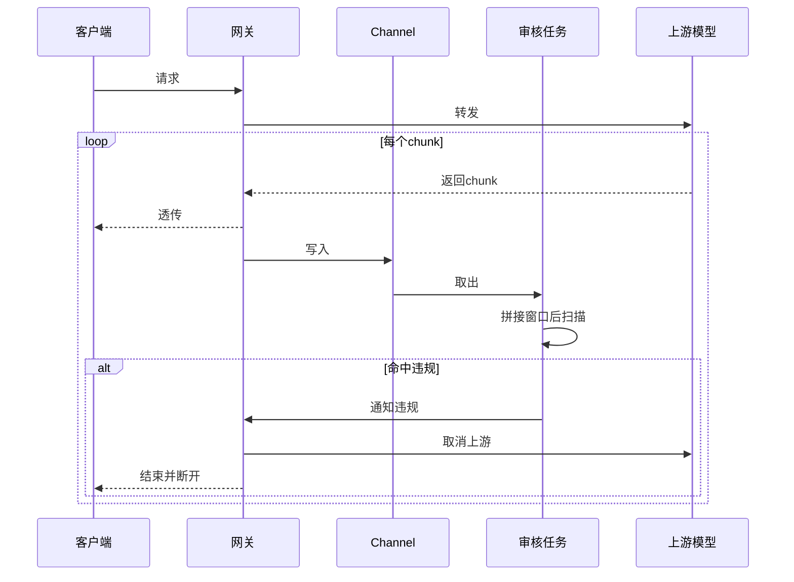

先看一个具体的麻烦。

同一个问答功能，产品要求中国用户走DeepSeek，日本用户走OpenAI。实现起来不难，业务代码里加一个if就行。

麻烦在后面。

新模型上线要改代码重新发版。某家供应商开始超时，得有人手动去切。月底对账，没人说得清钱花在哪。等到第五个团队都来调用，代码里已经摞了三层if。

这类事情攒到一起，就该在中间加一层网关。

## 网关管什么

我把它分成五块。

接入层负责收请求。路由编排决定这次调用落到哪家模型、哪个版本。鉴权配额管身份、限流和钱。内容审核负责合规。可观测负责回答“为什么慢了”。

业务语义不进来。prompt怎么拼、上下文怎么截断，仍然是应用层的事。

用C#做，不一定非要引第三方网关库，原生组件够用。

| 要解决的事 | 用什么 |
| --- | --- |
| 转发请求 | `IHttpClientFactory` 加命名客户端 |
| 横切逻辑 | `Middleware` |
| 流式转发 | `IAsyncEnumerable` 与 `System.IO.Pipelines` |
| 生产和消费解耦 | `System.Threading.Channels` |
| 限流 | `System.Threading.RateLimiting` |
| 埋点 | `ActivitySource`、`Meter` |
| 后台任务 | `BackgroundService` |

少一层依赖，好处是出问题能直接看代码，坏了也好调。代价是所有轮子自己造，后面几节基本都在补这个代价。

## 路由不该写死在代码里

普通业务里，`/api/user` 映射到某个Controller，写死没什么问题，路由目标几年都不变。

AI网关不一样，它的目标是外部的模型供应商，而这些供应商换得很快。

我数过四个必须动态的理由。

第一，模型迭代太快。今天接DeepSeek，明天换内部新模型，写死就意味着每次发版。

第二，灰度。按Header或者按比例把流量切给新模型，路由表里加个权重字段就够了，写死在代码里很难做。

第三，容灾。某家连续超时就得切走，等它恢复了再放回来，这个动作不该等人。

第四，多租户。免费用户走便宜的模型，付费用的旗舰模型，同一个入口按租户分流。

路由表放数据库，字段大致这些。

| 字段 | 作用 |
| --- | --- |
| `RouteKey` | 匹配条件，比如 `Region:CN` |
| `ProviderName` | 走哪家 |
| `EndpointUrl` | 实际地址 |
| `Weight` | 分流比例 |
| `Priority` | 主选还是备选 |
| `Status` | 健康状态 |
| `UpdateTime` | 增量同步用 |

网关起一个 `BackgroundService` 定时拉，或者订阅Redis的变更通知。拿到数据后在内存里构造一份新的 `ConcurrentDictionary`，然后整体替换引用。

这里我倾向用整表替换，而不是逐条改。读请求永远看到一份完整快照，不用加锁，也不会有改到一半的状态。

中间件解析请求头，从字典里查出候选列表，O(1)。

## 按地域分流

中国走DeepSeek，日本走OpenAI，判定顺序是先看认证Token里的Region声明，没有声明再用GeoIP解析IP兜底。

这个顺序有讲究。登录用户的地域信息是确定的，不该被IP误判，只有匿名请求才需要兜底。

跨境这一段容易漏。访问OpenAI这类目标，在注册命名客户端时要单独配代理，走专线或者出海通道。访问国内供应商直接走内网。混在一起配，要么慢，要么不通。

## 供应商挂了怎么办

内存里维护一份健康状态，记录每个供应商的连续失败次数和最后一次失败时间。

真正的拦截点放在 `DelegatingHandler` 里。它卡在HTTP管道上，能做三件事。

请求发出前看状态，熔断中就直接跳过，取备选。

请求过程中捕获超时、网络异常、5xx和429，失败计数加一。到阈值就标成不健康，转Fallback重发。

重试要带退避，而且要有抖动。没有抖动的话，故障那一刻所有请求同时重试，等于自己再打一遍。

恢复靠半开探测。后台服务定时给不健康的供应商发个轻量请求，比如列一下模型，通了就重置状态。同时只放一个探测请求出去，其余的继续走备用，不然探测本身又是一波流量。

还有一个必须写的兜底。数据库挂了，继续用内存里最后一次加载的配置；内存也空，退回代码里的静态默认路由。

## 内容审核不能等全文

AI场景和传统审核最大的差别在流式。

等全文生成完再审，用户要盯着空白页等几十秒，体验上等于没有流式。

输入这一侧相对简单。中间件里开 `EnableBuffering()` 打开Body缓冲，把prompt取出来，送给自己部署的审核模型判一遍。

为什么不直接用敏感词表。词表能拦住脏字，拦不住“换个说法绕过去”这类，小模型能看懂意图，判得准一些。

代价是延迟和资源。本地推理一般几十到几百毫秒，这段等待要算进用户的首字时间。模型本身占GPU，等于和上游业务抢卡。所以我会给它单独设超时，超了就按事先定好的策略走，别让审核把主链路拖死。

命中就在网关直接返回合规错误码，请求根本不发给上游，省下来的token都是钱。

输出这一侧麻烦。

用 `IAsyncEnumerable` 逐块读上游的流，别用 `ReadAsStringAsync` 一次读完，那样内存和延迟都难看。

中间加一个 `Channel`，把转发和审核拆开。审核慢的时候不会堵住主链路。

滑动窗口是为了解决跨块问题。“炸”和“弹”分在两个chunk里，单看哪个都正常。缓冲区要保留上一块结尾的几个字，我的做法是每次取20字，向后重叠5字。

命中违规就 `CancellationTokenSource.Cancel()`，向上游发取消信号，向下游发结束标志再断开。上游那边的token还能省下来一部分。

同步等审核完再透传，还是先透传再异步审，这是个取舍。图里画的是后者，首字快，可违规内容可能已经露出去了，只能事后清屏。前者安全但慢。按业务的严格程度选，没有标准答案。

审核别做成硬依赖。超时、熔断、降级要提前定好，超时之后是放行还是拦截，写进配置，不能等线上出事再临时商量。

## 鉴权其实是为了计费

很多人以为鉴权是防陌生人。在AI网关里，它更大的作用是把钱管住。

Key的校验很简单。数据库不存明文，存SHA256哈希。中间件算哈希，查Redis拿元数据，高频Key再用 `IMemoryCache` 做本地二级缓存。

本地缓存只放不常变的租户信息。变更走Redis的发布订阅广播失效，多实例下别指望本地缓存一致。

限流用 `System.Threading.RateLimiting`，令牌桶，以租户ID作为分区键。超了返回429，带上 `Retry-After`，告诉对方什么时候再来，比直接掐断友好。

有个坑。单实例的本地桶，扩容之后就不准了，五个实例等于五倍配额。要全局精准，只能上Redis加Lua，或者做滑动窗口。

计费才是真正麻烦的地方。Token消耗要等响应结束才知道，流式更长。

我的做法是两步。请求进模型前，按prompt长度估一个量，先在Redis扣掉，不够就直接拒。这一步防的是并发超支。

响应结束后解析 `usage`，算实际消耗，异步回写数据库并退差额，不阻塞主线程。

还有一种情况，用户中途断线。不处理的话，预扣的额度就悬在那了。监听 `HttpContext.RequestAborted`，一断开就取消上游，在 `finally` 里按已经收到的数据估算结算，或者直接退回。

## 出问题要看得出慢在哪

流式请求的耗时可能是几十秒，日志里只有一行“200 OK”，排障基本靠猜。

可观测就三样东西。

Trace用 `ActivitySource`。入口建一个Activity拿到TraceId，路由、审核、调模型各开子Span。查慢请求时一眼能看出是模型慢，还是审核卡住了。

Metrics用 `Meter`。请求数、错误率、各供应商的P50和P99、Token消耗速度。`Meter` 自带的Counter和Histogram够用。

Logs用 `ILogger` 输出JSON，带上TraceId、租户和目标模型。

两个细节容易被忽略。

流式请求的Span要活到流结束才上报，中途被取消就标成Canceled，并且记一次异常中断，这种中断在指标里通常是看不见的。

海量请求不能同步上报。错误全采样，成功按比例采样，比如一成。

再往前一步是闭环。后台服务定时读最近几分钟的错误率，某个供应商持续超标，就自动写进路由表标成不健康。告警和熔断走同一条链路，不用人工介入。

## 几处绕不开的取舍

| 取舍 | 偏这边 | 偏那边 |
| --- | --- | --- |
| 审核时机 | 先透传再异步审，首字快 | 审完再发，安全但慢 |
| 限流位置 | 本地桶，简单但扩容后不准 | Redis全局限流，准但多一跳 |
| 重试策略 | 重试即省钱，但可能重复计费 | 不重试，把错误抛给调用方 |
| 配置兜底 | 内存快照，够用 | 本地文件，能扛重启 |

没有哪个一定对。看业务能接受哪种失败。

## 最后说顺序

如果从零开始做，我会先落路由、鉴权和可观测这三块。

路由让换模型不用发版，鉴权让成本可控，可观测让前面两件事出了问题能查。这三样做完，网关就能跑了。

内容审核按合规要求加，业务没要求可以后置。缓存、灰度权重、多租户计费那些，等主链路稳了再说。

网关这东西的难点不在转发，在边界。哪些事该它做，哪些事做了反而添乱，这一步想清楚，后面都顺。
