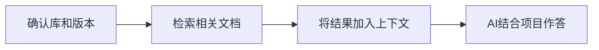

让AI写代码，偶尔会得到这种结果。语法看着没问题，用的却是旧API，甚至调用了不存在的方法。

常见原因是模型手上的资料和项目版本对不上。Context7做的事，就是在回答前先去查相关文档，把说明和代码示例递过去。[官方介绍](https://github.com/upstash/context7)

## 一、查询链路

整条链路可以分成四步：



这几步分属不同角色。模型判断需要查什么。AI应用里的MCP客户端负责发请求。Context7的MCP服务端校验参数、调用后端，再把结果送回来。

真正的文档搜索由后端完成。

应用连上服务端后，通过`tools/list`取得工具名称、用途和参数结构，再把这些信息交给模型。模型提出调用，客户端通过`tools/call`执行。[MCP架构](https://modelcontextprotocol.io/docs/2026-07-28/learn/architecture)

Context7的MCP查询主要用两个工具：

| 工具 | 必需参数 | 作用 |
| --- | --- | --- |
| `resolve-library-id` | `libraryName`、`query` | 搜索候选库并取得库ID |
| `query-docs` | `libraryId`、`query` | 在指定库中查询文档 |

通常先确定资料来源，再查具体问题。用户手上已经有准确的库ID时，第一步可以跳过。[工具说明](https://github.com/upstash/context7#available-tools)

## 二、两步查询

比如要弄清React的Effect清理机制，可以先向`resolve-library-id`传入：

```json
{
  "libraryName": "React",
  "query": "查找React useEffect清理行为的文档"
}
```

这里的库名用于搜索，问题描述用于判断相关性。返回的候选还可能带来源信誉、示例数量、质量评分和版本信息。

模型或应用据此挑出合适的库ID。评分和示例数量只能算参考，来源对不对、版本适不适用，仍然要自己看。

接着向`query-docs`提交具体问题：

```json
{
  "libraryId": "/reactjs/react.dev",
  "query": "依赖改变和组件卸载时，useEffect怎样执行清理？"
}
```

上面只展示参数写法，示例ID要以实际解析结果为准。

查询最好带上API名称、场景和待确认的行为。“hooks”这种问法范围太大，“依赖改变后，清理函数与下一次Effect谁先执行”就清楚得多。几个独立主题可以分开查。

服务端收到参数后，去请求Context7后端，再把返回文本放进MCP结果的`content`字段。内容通常是相关解释、示例和来源位置。[MCP实现](https://github.com/upstash/context7/blob/master/packages/mcp/src/index.ts)

模型拿到的是其中一部分资料，读完还要自己判断够不够。有缺口就调整问题补查。

工具说明里建议每个问题对每个工具最多调用3次，所以补查要围绕缺的那块信息展开。

## 三、文档索引

这些资料来自事先建好的文档索引。Context7读取来源内容，提取说明与示例，建成一个可以查询的索引。

维护者能用`context7.json`设置收录范围；普通使用者只是查文档，不用创建这份配置。

仓库缺文档时，公共库会自动尝试从源码生成示例，私有库则需要主动开启。所以返回内容也要结合来源判断。[文档入库说明](https://context7.com/docs/adding-libraries)

检索时，系统先找语义相关的候选，再对结果排序。REST接口的`fast=true`能跳过LLM重排序，延迟低一些，但相关性可能受影响；走MCP调用时，以实际发现的参数结构为准。[检索接口](https://context7.com/docs/api-reference/context/get-documentation-context)

MCP服务端源码是公开的，后端、抓取和解析引擎没公开。功能上可以把这套流程理解成RAG，但它到底用了什么模型、怎么切文档、召回多少片段，不能拿常见RAG方案去推。[源码范围](https://github.com/upstash/context7#disclaimer)

## 四、连接方式

连接Context7，常见两种方式：

| 方式      | 请求路径                      |
| ------- | ------------------------- |
| 本地stdio | 应用 → 本机MCP进程 → Context7后端 |
| 远程HTTP  | 应用 → 托管MCP服务 → Context7后端 |

本地方式跑的是`@upstash/context7-mcp`适配进程，查询照样要访问后端。远程方式直接连`https://mcp.context7.com/mcp`。两者的区别主要在进程位置、通信方式和认证配置。

|执行内容|本机MCP进程|托管MCP服务|
|---|---|---|
|接收参数、执行工具处理函数|你的电脑|Context7的服务器|
|请求检索后端、包装返回结果|你的电脑|Context7的服务器|
|文档索引与实际检索|Context7云端后端|Context7云端后端|

例如，`query-docs`的处理函数主要就做这件事：

```
接收查询参数 → 请求Context7后端 → 把结果包装成MCP响应
```

本地方式在你的电脑上执行这段代码，托管方式在远程服务器上执行。两条路最后都请求Context7的云端检索后端，文档索引并没有跟着本机MCP进程下载下来。

## 五、资料如何参与回答

查询结果交给模型后，就成了本次回答的参考资料。应用负责安排这些内容进上下文，并管理保留和压缩。这个过程不会更新模型权重。

MCP管工具通信，RAG描述检索资料怎么参与生成。Context7提供文档，模型负责结合任务使用；后面改代码、跑测试，交给其他工具。
