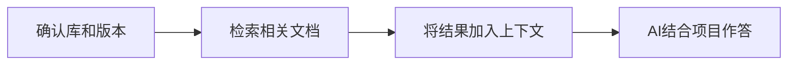

让AI写代码，有时会得到这样的结果：语法看着没问题，用的却是旧API，甚至调用了不存在的方法。

一个常见原因是，模型掌握的资料与项目版本不一致。Context7的作用，就是在回答前查找相关文档，把说明和代码示例交给AI参考。[官方介绍](https://github.com/upstash/context7)

## 一、查询链路

整条链路可以分成四步：



这几步涉及不同角色。模型判断需要查什么；AI应用中的MCP客户端发送请求；Context7 MCP服务端校验参数、调用后端，再返回结果。

真正的文档搜索由后端完成。

应用连接服务端后，通过`tools/list`取得工具名称、用途和参数结构，再把这些信息提供给模型。模型提出调用，客户端通过`tools/call`执行。[MCP架构](https://modelcontextprotocol.io/docs/2026-07-28/learn/architecture)

Context7的MCP查询主要使用两个工具：

| 工具 | 必需参数 | 作用 |
| --- | --- | --- |
| `resolve-library-id` | `libraryName`、`query` | 搜索候选库并取得库ID |
| `query-docs` | `libraryId`、`query` | 在指定库中查询文档 |

通常先确定资料来源，再查具体问题。用户提供准确的库ID时，可以跳过第一步。[工具说明](https://github.com/upstash/context7#available-tools)

## 二、两步查询

比如，要了解React的Effect清理机制，可以先向`resolve-library-id`传入：

```json
{
  "libraryName": "React",
  "query": "查找React useEffect清理行为的文档"
}
```

这里的库名用于搜索，问题描述用于判断相关性。返回的候选还可能带有来源信誉、示例数量、质量评分和版本信息。

模型或应用据此选出合适的库ID。评分和示例数量只能作为参考，来源是否正确、版本是否适用，同样需要检查。

随后，向`query-docs`提交具体问题：

```json
{
  "libraryId": "/reactjs/react.dev",
  "query": "依赖改变和组件卸载时，useEffect怎样执行清理？"
}
```

上面仅展示参数写法，示例ID需以实际解析结果为准。

查询最好带上API名称、场景和待确认的行为。“hooks”范围太大，“依赖改变后，清理函数与下一次Effect谁先执行”就清楚得多。多个独立主题可以分别查询。

服务端收到参数后，请求Context7后端，再把返回文本放进MCP结果的`content`字段。内容通常包含相关解释、示例和来源位置。[MCP实现](https://github.com/upstash/context7/blob/master/packages/mcp/src/index.ts)

模型拿到的是一部分相关资料，读完后仍要判断是否足够。存在缺口时，可以调整问题补查。

工具说明建议每个问题对每个工具最多调用3次，因此补查应围绕缺失信息展开。

## 三、文档索引

这些资料来自预先建立的文档索引。Context7读取来源内容，提取说明与示例，建立可供查询的索引。

维护者可以用`context7.json`设置收录范围；普通使用者查询文档时，无须创建这份配置。

仓库缺少文档时，公共库会自动尝试从源码生成示例，私有库则需要主动启用。因此，返回内容也要结合来源判断。[文档入库说明](https://context7.com/docs/adding-libraries)

检索时，系统先寻找语义相关的候选，再对结果进行排序。REST接口的`fast=true`可以跳过LLM重排序，降低延迟，但可能影响相关性；MCP调用应以发现的参数结构为准。[检索接口](https://context7.com/docs/api-reference/context/get-documentation-context)

MCP服务端源码已公开，后端、抓取和解析引擎仍未公开。可以从功能上把这套流程理解为RAG，但具体使用哪种模型、怎样切分文档、召回多少片段，不能凭常见RAG方案推断。[源码范围](https://github.com/upstash/context7#disclaimer)

## 四、连接方式

连接Context7，常见的方式有两种：

| 方式      | 请求路径                      |
| ------- | ------------------------- |
| 本地stdio | 应用 → 本机MCP进程 → Context7后端 |
| 远程HTTP  | 应用 → 托管MCP服务 → Context7后端 |

本地方式运行的是`@upstash/context7-mcp`适配进程，查询仍然需要访问后端。远程方式则直接连接`https://mcp.context7.com/mcp`。两者的区别主要在进程位置、通信方式和认证配置。

|执行内容|本机MCP进程|托管MCP服务|
|---|---|---|
|接收参数、执行工具处理函数|你的电脑|Context7的服务器|
|请求检索后端、包装返回结果|你的电脑|Context7的服务器|
|文档索引与实际检索|Context7云端后端|Context7云端后端|

例如，`query-docs`的处理函数主要做这件事：

```
接收查询参数 → 请求Context7后端 → 把结果包装成MCP响应
```

本地方式在你的电脑执行这段代码；托管方式在远程服务器执行这段代码。两种方式最终都请求Context7的云端检索后端，文档索引并没有随本机MCP进程一起下载到电脑上。

## 五、资料如何参与回答

查询结果交给模型后，就成为本次回答的参考资料。应用负责安排这些内容进入上下文，并管理保留和压缩。这个过程不会更新模型权重。

MCP负责工具通信，RAG描述检索资料如何参与生成。Context7提供文档，模型负责结合任务使用；后续修改代码和运行测试，则交给其他工具。

