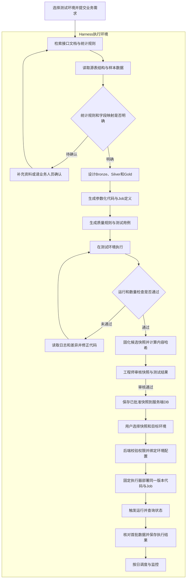

本文以Databricks on AWS为例，企业通过已有同步任务，把ERP中的销售、采购、库存和财务数据增量写入S3，再由Databricks加工成报表需要的数据。AI Agent接入经过授权的查询和开发工具，读取业务文档、表结构、数据及任务日志，协助完成后续工作。

下面用四个ERP场景，对比传统做法和AI方式。

## 一、数据工程

以制造企业的直营网点为例，运营负责人提出一个需求：

> 每天早上8点前，告诉我昨天每家门店、每种商品卖出了多少件。只统计已完成订单，取消和待处理订单不算，同一条订单明细重复同步也只能计算一次。

例如，东店卖出2个水杯和1个饭盒，西店卖出3个水杯，日报就应该显示两家店合计卖出6件商品。

这个需求容易理解，但要每天稳定出结果，仍然需要完成找表、关联、去重、汇总、验证和部署。

### 传统方式

数据工程师通常分五步完成。

1. 确认统计规则。哪些状态表示订单已完成？按创建日期还是完成日期统计？销量取哪个数量字段？
2. 找到数据来源。阅读ERP接口文档，找到订单头表、订单明细表、门店表和商品表，确认它们怎样关联。
3. 设计加工流程。决定原始记录怎样保留、重复记录怎样处理、订单更新后怎样重算，再划分Bronze、Silver和Gold。
4. 编写与调试。用PySpark和SQL实现转换、关联和汇总，配置Lakeflow Jobs及任务依赖，处理重复同步和失败重跑。
5. 验证与上线。拿几笔订单手工计算，核对门店、商品和件数，检查运行时间，评审后部署。

这里有两个容易忽略的地方。

一个是数据分散。订单头表记录门店、订单状态和完成时间，订单明细表才有商品和数量，需要关联后才能统计。

另一个是重复同步。ERP可能先发来一条订单明细，稍后又把同一条记录发一次。直接把S3里的数量相加，就会把销量算多。

### AI方式

工程师提供ERP接口文档、已经确认的统计规则和几笔样例订单，并给Agent一个任务：

> 按订单完成日期统计每家门店、每种商品的销量，生成Bronze、Silver和Gold三层处理流程，以及PySpark、SQL和任务配置。过滤取消及待处理订单，处理重复同步和订单更新。先在测试环境验证，通过后整理成可审核的发布快照。

这里可以引入Harness工程的思路：围绕Agent，把上下文、工具、执行环境、任务状态和验证反馈一起设计好，让它能够持续推进任务、根据结果修正，并在需要时暂停或恢复。

在这个ERP项目里，Harness还要把验证通过的代码、Job定义和校验规则固定成发布快照。Agent在测试阶段生成和修正，正式发布则由执行器按审核后的版本完成。

用户在启动测试任务时选择测试环境，后端加载对应配置并绑定到本次任务。后续发布时，再选择已获准使用的目标环境。整体流程如下：



#### Harness工程的具体落点

图里的检索、编码、测试和发布，都需要相应的工程机制承接。在本例中，可以落实为下面几项：

| 建设项   | 在门店销量日报中的做法                                             |
| ----- | ------------------------------------------------------- |
| 上下文组织 | 维护订单状态、销量字段、表关联关系和接口版本，按当前任务检索相关内容                      |
| 工具接口  | 测试阶段提供读表、执行SQL和测试工具；正式发布提供执行已批准快照和查询进度的工具               |
| 执行环境  | 用户显式选择测试或生产配置，后端按任务加载并绑定，区分工作区、数据目录、路径和运行身份             |
| 状态与恢复 | 保存快照版本、环境配置版本、执行步骤及`job_id`、`run_id`；中断后核对实际状态，再决定重试或继续 |
| 验收与退出 | 独立检查程序执行运营确认的预期件数；达到超时、修正次数或成本上限时保留记录并转人工               |
| 发布约束  | 审核绑定具体快照和获准使用的环境配置版本，执行器使用已保存的代码与步骤，变更后重新验证相应版本         |

例如，样例订单实际卖出6件商品，测试程序却算出8件，就把预期值、实际值、相关订单明细和执行日志一起返回。Agent根据这组反馈检查重复记录，再修正处理逻辑。测试环境、检查程序和结果反馈都属于Harness的组成部分。

问题解决后，还可以把“订单重复同步”“取消订单被计入”“订单状态发生更新”等情况保留为回归案例。以后更换模型、提示词或工具时，在测试环境重新运行这些任务，检查Agent能否按相同规则算对销量、完成部署，同时比较人工介入次数、耗时和成本。

下面按开发顺序，展开每一步的具体产出。

#### 1. 整理字段映射

Agent先检索业务文档，再通过工具读取表结构和少量样本，整理出字段映射草稿。

| 需要明确的内容 | 本例要核对什么                      |
| ------- | ---------------------------- |
| 订单与明细标识 | 哪些字段可以唯一识别一条明细，例如门店编号、订单号和行号 |
| 统计日期    | 哪个字段代表订单完成时间，与创建时间是否不同       |
| 订单状态    | 哪个代码表示已完成，哪些表示取消或待处理         |
| 商品与数量   | 哪个字段代表商品编号，哪个字段是件数           |
| 增量信息    | 怎样识别新增、更新和删除，哪个字段可以判断记录版本    |
| 表关联关系   | 订单头与明细怎样关联，门店和商品名称从哪里取得      |

如果接口里的状态值是`30`，Agent需要从文档或样例中确认它是否表示“已完成”。字段名和数据类型能帮助定位，状态含义仍需要业务依据。

#### 2. 设计三层数据

字段和规则明确后，Agent提出分层方案：

| 分层 | 本例中的设计 | 得到什么 |
| --- | --- | --- |
| Bronze | 接收S3中的ERP原始增量，保留来源和接收信息 | 原始订单、明细、门店和商品记录，方便追溯 |
| Silver | 按业务键和版本处理重复与更新，关联订单头和明细，再取得门店及商品信息 | 每条订单明细对应一条当前记录，带状态、完成时间、门店、商品和件数 |
| Gold | 选取已完成订单，按完成日期、门店和商品汇总件数 | 每日门店商品销量表 |

例如，Silver保留“东店、订单S001、第1行、水杯、2件、已完成”。同一条明细收到两次，也只在当前结果中保留一条。

Gold再把同一天、同一家店、同一种商品的件数相加。门店和商品关联前，还要检查主数据的关联键是否唯一，避免一条明细匹配出多行。

#### 3. 生成代码与任务配置

设计通过审核后，Agent生成相应的PySpark、SQL和Lakeflow Jobs配置草稿。

代码从一开始就通过参数引用Catalog、Schema和S3路径。Job使用逻辑名称，部署时再取得目标环境的实际ID，避免直接沿用测试环境的`job_id`。依赖包也记录确定版本，便于正式发布使用同一份代码和依赖产物。

除了正常转换，还需要处理几个运行问题：

- 同一条明细重复到达时，按业务键和版本判断应保留哪条记录。
- 订单状态或数量更新时，同步更新相关明细，重新计算受影响门店和日期的销量。
- 门店或商品信息暂时缺失时，记录无法关联的明细，按已确认规则告警或等待补齐。
- 任务失败后再次执行时，处理已经写入的部分结果，避免重复追加。

任务可以按“原始数据接收、订单明细整理、明细检查、销量汇总、结果校验”建立依赖。源数据尚未到齐或检查失败时，流程报告问题，避免把不完整结果当成当天的正式日报。

#### 4. 执行样本与质量检查

运营人员确认下面五条样例明细。已完成订单的完成日期都在昨天，商品数量统一按件计算。

| 订单号 | 行号 | 门店 | 状态 | 商品 | 件数 |
| --- | --- | --- | --- | --- | ---: |
| S001 | 1 | 东店 | 已完成 | 水杯 | 2 |
| S001 | 2 | 东店 | 已完成 | 饭盒 | 1 |
| S002 | 1 | 东店 | 已取消 | 水杯 | 4 |
| S003 | 1 | 西店 | 已完成 | 水杯 | 3 |
| S004 | 1 | 西店 | 待处理 | 饭盒 | 2 |

按照“只统计已完成订单”的规则，日报应该得到：

| 门店 | 商品 | 昨日销量 |
| --- | --- | ---: |
| 东店 | 水杯 | 2件 |
| 东店 | 饭盒 | 1件 |
| 西店 | 水杯 | 3件 |
| 合计 | 全部商品 | 6件 |

Agent据此生成检查用例，并运行SQL或测试程序：

| 检查项 | 验证方法 |
| --- | --- |
| 状态过滤是否正确 | 确认取消订单的4件和待处理订单的2件都未计入 |
| 同步重复是否被处理 | 把S001第1行再输入一次，最终销量仍应为6件 |
| 主数据关联是否重复 | 比较关联前后的明细行数和件数 |
| 重跑结果是否一致 | 对同一批输入执行两次，最终仍是三行门店商品汇总，合计6件 |
| 订单更新是否生效 | 将S003的数量从3件改成4件，西店水杯销量应变为4件，合计变为7件 |

这里的合计行用于展示和校验，Gold表保存按日期、门店和商品分组的三条结果，避免后续查询时再次把合计行加进去。

#### 5. 根据失败结果修正

假设S001第1行的“2个水杯”被重复同步了一次，Silver层的代码却只统一了字段，没有处理重复记录。

程序就会算成2＋2＋1＋3＝8件，而正确结果是6件。

Agent可以沿着差异继续查：

1. 读取失败用例，发现东店水杯多出2件。
2. 查询对应明细，找到两条门店、订单号和行号都相同的记录。
3. 对照接口说明，确认它们是同一条业务明细的重复同步。
4. 修正Silver逻辑，按业务键和版本保留最新记录，再重新汇总Gold。
5. 再次执行检查，确认东店水杯恢复为2件，总销量恢复为6件，同时订单更新用例仍能通过。

这里能体现AI的作用：它把数量差异、源数据和接口说明联系起来，提出修改，再用执行结果验证。若几轮修改后仍无法解释差异，就保留证据并交给工程师处理。

#### 6. 审核并保存发布快照

测试通过后，Agent把本次实际验证的代码、依赖和Job定义整理成候选发布快照，例如`sales-v3`。快照包含后续真正要执行的代码和配置，测试过程中的查询、失败尝试及日志作为关联记录保存。

| 快照内容 | 本例保存什么 |
| --- | --- |
| 代码与Job定义 | Bronze、Silver、Gold的代码，任务依赖和执行顺序 |
| 依赖与校验规则 | 确定版本的依赖包，状态过滤、去重和数量核对规则 |
| 参数定义 | 哪些值由环境配置提供，哪些值允许在每次运行时传入，以及对应类型和范围 |
| 验证与审核依据 | 样例输入及预期结果、测试报告、内容哈希和审核记录 |

工程师审核代码、统计规则和验证结果。审核通过后，服务端保存已批准快照，记录允许使用的目标环境配置版本。内容哈希用于核对后续执行的产物是否与审核版本一致。

这些内容可以保存在服务端DB。代码包较大时，也可以将文件存到S3，DB保存对应的版本地址、哈希和关联记录。以后需要修改代码、Job执行逻辑或校验规则，就生成新版本，重新验证和审核。

#### 7. 选择环境并执行固定版本

用户发布时，选择快照`sales-v3`和生产环境配置。后端检查该用户的发布权限，以及快照是否获准使用这个配置版本，再将选定的快照和环境配置一并绑定到本次执行。

同一份代码通过配置访问不同资源。例如：

| 配置项 | 测试环境 | 生产环境 |
| --- | --- | --- |
| Databricks工作区 | 测试工作区 | 生产工作区 |
| Catalog | `sales_test` | `sales_prod` |
| 订单来源路径 | 测试订单所在的S3路径 | 正式订单所在的S3路径 |
| 运行身份 | 测试运行身份 | 生产运行身份 |

这些值可以通过环境变量或配置文件注入执行进程。每次任务使用已经绑定的配置，模型接收明确的环境标识和可用资源信息，密钥由后端管理。

统计日期、批次号等属于每次运行的业务参数，单独传入。这样，固定代码、环境配置和运行参数各有自己的用途。

正式发布可以通过函数调用接入后端。模型发出工具调用，后端执行实际操作，再返回结果，符合Function Calling的工作方式。

本例可以封装两个函数，名称由项目定义：

| 示例函数 | 执行动作 |
| --- | --- |
| `execute_snapshot` | 接收快照ID和允许的运行参数，使用后端绑定的环境配置，校验、部署并触发已批准版本 |
| `get_execution` | 按执行ID查询发布步骤、Job运行状态、数量检查结果和错误信息 |

执行器先核对调用中的快照ID是否与本次绑定一致，参数不符时返回错误。随后按固定步骤完成工作：

1. 读取快照，核对内容哈希、审核状态和环境配置版本，检查目标表结构、访问权限及依赖条件。
2. 只替换快照中声明的环境参数，将已保存的代码和依赖产物部署到目标工作区，创建或更新对应Job。
3. 触发运行并保存`job_id`、`run_id`。同一次触发请求重试时复用幂等标识，避免重复启动。
4. 查询运行状态，完成后执行快照中的校验规则，记录发布和运行结果。


对于门店销量日报，生产结果按当天真实订单计算，再使用相同的状态过滤、去重和数量核对规则检查。测试样本中的6件用于回归验证，正式日报的件数取决于实际订单。

执行失败时，后端记录已完成步骤、受影响批次和错误，按既有方案回退代码配置或补跑数据。Agent可以查询记录、解释问题；需要修改逻辑时，回到测试流程形成新版本。

这套设计减少了发布时临时生成和修改代码带来的不确定性。测试覆盖不足、生产数据差异或表结构变化仍可能影响结果，因此环境检查和运行后的校验继续保留。

### Harness工程解决了什么问题

在门店销量日报这个例子中，Harness把资料、工具、测试和发布连接起来，让Agent的工作有明确输入、真实反馈和可追溯的结果。它主要解决下面几类问题：

| 问题 | 本例中的处理方式 |
| --- | --- |
| 业务资料分散，字段和规则容易理解错 | 维护可检索的接口文档、状态说明和字段映射，缺少依据时补充确认 |
| 代码已经生成，但结果是否正确缺少依据 | 独立执行测试，将“预期6件、实际8件”等差异反馈给Agent，修正后重新验证 |
| 测试通过后，发布版本又发生变化 | 用快照保存已验证的代码、依赖和Job定义，审核绑定具体版本，执行器核对哈希后部署 |
| 测试与生产资源容易混用 | 用户显式选择环境，后端绑定获准使用的配置，按声明的参数替换目标资源 |
| 任务中断后，不清楚做到哪里 | 保存步骤、执行ID和Job运行记录，核对实际状态后决定继续或重试 |
| 同类错误反复出现 | 将重复同步、状态过滤等失败情况沉淀为回归案例，后续变更时再次验证 |

工程师负责定义规则、验收和审核；Agent在测试阶段理解需求、生成代码并根据反馈修正；固定执行器负责部署和运行已批准快照。验证通过的成果因此可以按版本重复使用，后续发现的问题也能回到测试和工具中，成为下一次交付的检查依据。

## 二、DataOps

凌晨，ERP客户主数据接口升级，把客户分组字段`cust_group`改成了`customer_group`。

Silver层的转换代码还在使用旧字段，客户维表更新失败，销售汇总也无法继续。

```text
Job：erp_daily_sales
失败任务：build_customer_dimension
错误：UNRESOLVED_COLUMN: cust_group
业务影响：早上的销售看板未更新
```

### 传统方式

值班工程师收到告警，先找到最早失败的任务，读日志、看代码，再对比前后两批源数据。

看到新增字段后，还需要联系ERP接口负责人，确认这次只是改名，还是连分组含义也变了。然后查找下游依赖，评估哪些任务和报表受影响。

确认原因后，修改字段映射，测试并部署，再补跑任务和核对结果。

排查慢，常常是因为资料分散。任务日志、接口变更说明和下游依赖，需要分别查找。

### AI方式

告警触发Agent后，它通过工具收集证据：

| 调查动作 | 本例发现 |
| --- | --- |
| 读取失败日志 | 客户维表在选择字段时失败 |
| 对比源数据结构 | 旧字段消失，新增`customer_group` |
| 检索接口变更说明 | 只修改字段名，分组代码和含义保持一致 |
| 查询已有数据血缘 | 销售分组报表和应收账龄报表依赖这张维表 |
| 生成修改并验证 | 更新源字段映射，检查空值率、分组分布和关联成功率 |

最后，Agent给出一份可以复查的恢复方案：

- 根因是ERP接口改名，字段映射没有同步调整。
- 将新字段映射到原有内部字段名，减少对下游的影响。
- 测试通过后部署，补跑失败任务及相关依赖任务。
- 恢复后核对客户数量、销售金额和报表更新时间。

如果没有接口说明，两个字段是否等价就仍待确认。仅凭名字相似，无法证明业务含义相同。

Databricks的多任务Job可以通过Repair run恢复失败任务及相关依赖任务。重跑前要确认写入逻辑能否避免重复数据，因为任务可能在报错前已经写入部分结果。[任务修复说明](https://docs.databricks.com/aws/en/jobs/repair-job-failures)

这类应用的价值，是缩短收集证据和判断问题所需的时间。临时网络故障可能重试就能恢复，字段改名则需要先修复映射。

## 三、数据分析

财务经理比较两个完整月份，发现销售额相同，毛利率却下降了5个百分点。

已完成对账的数据如下，金额统一为人民币，不含税：

| 指标 | 上月 | 本月 | 变化 |
| --- | ---: | ---: | ---: |
| 销售净额 | 1,000万元 | 1,000万元 | 0 |
| 对应销售成本 | 750万元 | 800万元 | +50万元 |
| 毛利 | 250万元 | 200万元 | -50万元 |
| 毛利率 | 25% | 20% | -5个百分点 |

他想知道，这次变化主要集中在哪些产品、客户或工厂。

### 传统方式

分析师先检查两个期间的数据是否完整、计算口径是否一致，再用SQL或Excel按产品、客户、公司和工厂拆分。

找到变化最大的部分后，还要继续比较销量、折后售价、销售成本和产品组合，必要时追到出库成本与采购入库记录。

分析完成后，整理图表和单据明细，再请采购或生产部门核实。

如果经理继续问“去掉某个大客户后还下降吗”，通常需要调整查询，重新生成结果。

### AI方式

分析Agent先读取已经配置好的指标定义和表关系。毛利率按下面的公式计算：

> 毛利率＝销售净额减去对应销售成本，再除以销售净额。

这里使用与销售对应的已结转成本，当月采购金额不能直接替代。成本明细也要先按适当粒度汇总，再与销售关联，避免一对多连接造成重复计算。

Agent生成SQL，查询Databricks中的销售、成本和主数据，逐步下钻。本例得到的结果是：

> 销售净额维持在1,000万元，销售成本增加50万元。
>
> A类物料销售净额与上月持平，销售成本增加40万元，占本次成本增量的80%。其他物料合计增加10万元。
>
> 下一步优先拆分A类物料的销量、售价、出库单位成本和产品组合，列出变化最大的物料及对应单据。

经理可以继续追问具体产品、工厂和采购批次。Agent沿着问题查询，并保留SQL、指标定义和单据依据。

不过，“40万元成本增量集中在A类物料”与“供应商涨价导致毛利下降”，是两个层次的结论。

前者可以通过数据汇总验证；后者还需要采购批次、库存计价和成本结转记录支持。证据不完整时，就只能列为待验证原因。

这类应用适合管理层和业务部门。AI帮助用户连续追问，把查询结果组织成解释；具体金额和比例由SQL计算，业务判断保留可追溯的依据。

## 四、数据质量

采购收货单显示，某种物料入库50箱，每箱100件，金额10万元。

正确结果应是：

| 项目 | 正确值 |
| --- | ---: |
| 收货数量 | 50箱 |
| 换算关系 | 1箱＝100件 |
| 基本单位数量 | 5,000件 |
| 收货金额 | 100,000元 |
| 每件成本 | 20元 |

Databricks转换配置却误用了10,000作为换算系数，算出500,000件。金额没有变化，每件成本于是变成0.2元。

整个过程没有报错，所有Job都执行成功。

### 传统方式

现有检查可能只覆盖主键唯一、物料存在、收货数量为正、金额不为空。这条记录全部符合要求。

如果还没配置单位换算校验，问题可能等到库存分析、财务对账或月末盘点时才暴露。工程师再查ERP单据、原始文件和转换代码，修正数据并补上规则。

传统监控同样可以使用统计方法发现异常。这个例子中，原来的检查遗漏了数量、单位和金额之间的业务关系。

### AI方式

先由统计或机器学习方法检测异常。例如，该物料过去的每件成本主要在18～22元，这一批只有0.2元，基本单位数量也明显偏高。

Agent收到异常信号后，继续调查：

1. 检查是否存在批量采购、赠品、计价单位变更或主数据调整，判断变化是否合理。
2. 查询ERP收货单、S3原始数据、单位换算主数据和转换配置。
3. 核对50箱与每箱100件的关系，确认应为5,000件。
4. 找到配置中的错误系数，标记受影响批次，提出修正和重算方案。
5. 重算后核对库存数量与金额，确认影响是否已经消除。

本次调查还可以形成一条长期执行的校验规则：

> 按业务发生时有效的物料换算关系，检查基本单位数量是否等于业务单位数量乘以换算系数，并按业务要求设置容差。

规则经过审核，就可以用普通SQL或数据质量规则持续运行。统计方法负责发现可疑变化，Agent负责整理业务背景和调查证据，稳定的校验交给确定性规则执行。

Databricks的基础异常监控可以检查表的更新及时性和写入量。单位换算、价格合理性等ERP业务检查，需要另外设计。[异常检测说明](https://docs.databricks.com/aws/en/data-governance/unity-catalog/data-quality-monitoring/anomaly-detection)

这类应用关注任务成功之后的数据是否合理。它也能把一次排查的发现，转成后续反复使用的检查规则。

