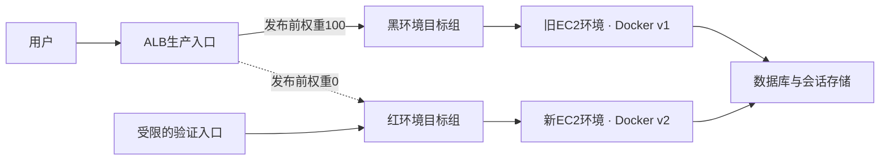

部署策略主要决定三件事：新版怎样进入生产、多少用户先接触新版，以及出问题后怎样退回。

下面比较常见做法。停机影响、资源投入和回滚速度都依赖具体实现，表中的特点不能代替容量验证。

| 策略             | 更新方式             | 对服务的影响               | 资源投入          | 回滚方式          | 主要难点            |
| -------------- | ---------------- | -------------------- | ------------- | ------------- | --------------- |
| 就地部署In-place   | 在现有实例上替换程序       | 全量同时更新通常需要停机，也可按批次执行 | 通常较低          | 重新部署旧版        | 更新期间的可用容量和失败恢复  |
| 滚动部署Rolling    | 逐台或分批更新实例、容器     | 容量充足且检查通过时，可保持服务     | 较低至中等，可临时增加容量 | 逐批恢复旧版        | 新旧版本在一段时间内共同运行  |
| 蓝绿部署Blue-Green | 先准备新环境，验证后切换流量   | 可减少更新造成的中断           | 通常较高，需要并行保留环境 | 旧环境仍可用时，把流量切回 | 环境一致性、共享数据与切换验证 |
| 金丝雀发布Canary    | 先让少量流量进入新版，观察后扩大 | 将初期影响限制在部分用户         | 取决于新环境规模      | 停止向新版分配流量     | 监控指标、分流规则和异常判断  |
| 红黑部署Red-Black  | 常作为蓝绿部署的另一种叫法    | 取决于环境和流量切换方式         | 与蓝绿部署相近       | 取决于旧环境是否仍然保留  | 旧环境的保留与清理时机     |

就地部署说明程序在哪里更新，滚动部署说明按什么顺序更新，两者可以同时成立。金丝雀也能用在蓝绿环境中：先切少量流量，再决定是否完整切换。[AWS部署策略](https://docs.aws.amazon.com/whitepapers/latest/introduction-devops-aws/deployment-strategies.html)

红黑部署并不统一要求成功后立刻销毁旧环境。清理得越早，占用资源越少，但快速切回的机会也会随之消失。

回滚还要考虑数据兼容。即使旧程序仍在，数据库结构或数据含义已经改变，也未必能直接切回。[蓝绿部署说明](https://docs.aws.amazon.com/whitepapers/latest/blue-green-deployments/introduction.html)

### 红黑部署

假设线上正在运行v1，现在要发布v2。红黑部署的做法，是先启动一套运行v2的新环境，验证通过后，把生产入口切到新环境，旧环境继续保留一段时间。

下面把旧环境称为黑环境，新环境称为红环境。颜色只是本次示例的约定，实际发布时，应根据流量规则判断哪套环境正在提供服务。

结合Jenkins和Docker，可以用下面这套AWS结构实现。

#### 部署结构

Jenkins负责构建和编排，ECR保存镜像，EC2运行容器，ALB负责分配请求。

准备两个目标组，分别对应两套独立的EC2应用环境。每套环境可以由一个Auto Scaling组管理，并按生产需求分布到多个可用区。

发布前，生产规则将黑环境的权重设为100，红环境的权重设为0。这样两组都与ALB关联，新环境可以接受健康检查，正常生产请求仍然进入旧环境。

验证入口可以使用同一个ALB上的独立测试监听器，只允许Jenkins所在网络访问。健康检查路径可以设为应用提供的就绪接口，例如 `/ready`，确认应用已经能接收请求。

这个示例关闭目标组粘性，让新请求按配置的权重分配。如果应用依赖粘性会话，需要先验证会话迁移行为。ALB支持对多个目标组设置转发权重。[ALB转发与粘性规则](https://docs.aws.amazon.com/elasticloadbalancing/latest/application/rule-action-types.html)

#### 一次发布的步骤

1. 构建镜像。Jenkins完成编译和测试后，把镜像推送到ECR，记录镜像digest。本次发布的所有实例都使用这个digest，保证运行的是同一份产物。

2. 启动新环境。使用已安装Docker的AMI，创建新环境的Launch Template和Auto Scaling组，在启动脚本中指定这次的镜像digest。把新ASG关联到红环境目标组，目标组端口对应容器映射的宿主机端口。EC2启动后登录ECR、拉取镜像并启动容器，ASG会自动注册实例。实例角色需要具备拉取镜像的权限，网络也要能访问ECR及应用依赖。

3. 验证新环境。先检查实例和目标数量是否达到预期，再等待目标健康。通过受限入口执行登录、查询、写入等核心链路测试，并确认新环境有能力承接完整生产负载。只返回一次HTTP 200，还不足以证明可以切流。

4. 切换生产流量。验证通过后，把黑环境权重改为0，红环境权重改为100。域名和ALB地址保持不变。规则更新需要传播，短时间内仍可能有请求按旧规则路由，所以两个版本需要允许短暂共存。[ALB规则更新说明](https://docs.aws.amazon.com/elasticloadbalancing/latest/application/edit-rule.html)

5. 保留并观察。旧环境继续运行，保留足够的回滚容量。持续检查新版的错误率、P95延迟和业务成功率，依据预先约定的阈值判断是否回滚。观察期可以先约定为30分钟，再按业务流量和故障发现周期调整。

6. 完成或回滚。观察通过后，注销旧目标并清理旧环境；出现异常时，先确认旧环境仍健康，再把生产权重切回去。切流前验证失败时，保持旧环境服务，只清理失败的新环境。

Jenkins中的阶段可以依次安排为“构建与测试 → 推送镜像 → 部署新环境 → 验证 → 切流 → 观察 → 清理”。

同一应用的生产发布需要加环境锁，从选择环境一直覆盖到观察和回滚结束，避免两次发布同时改ALB规则。Jenkins可以使用Lockable Resources插件的`lock`步骤实现；多个发布任务需要约定同一个资源名。[Jenkins环境锁](https://www.jenkins.io/doc/pipeline/steps/lockable-resources/)

