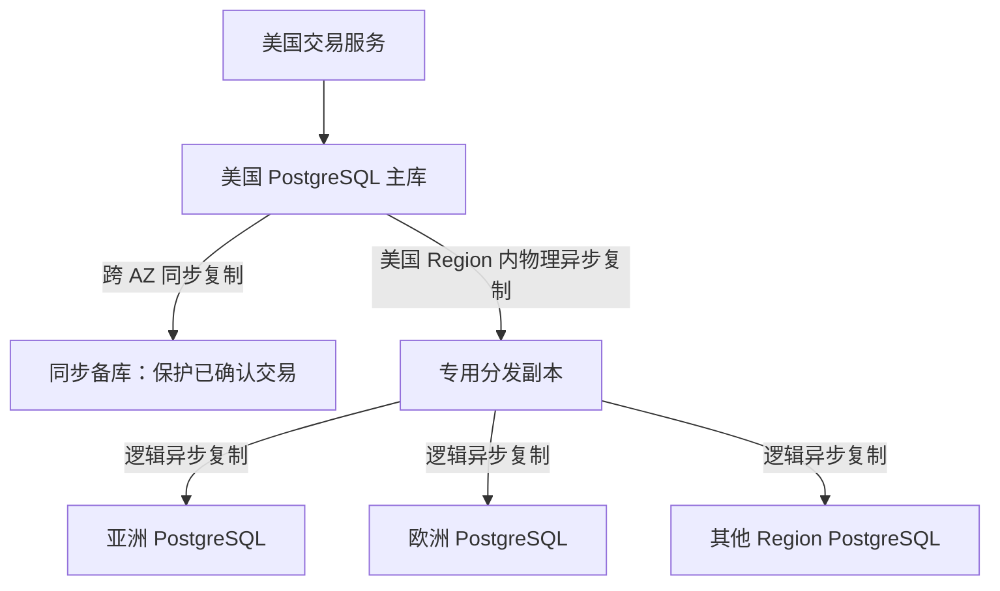
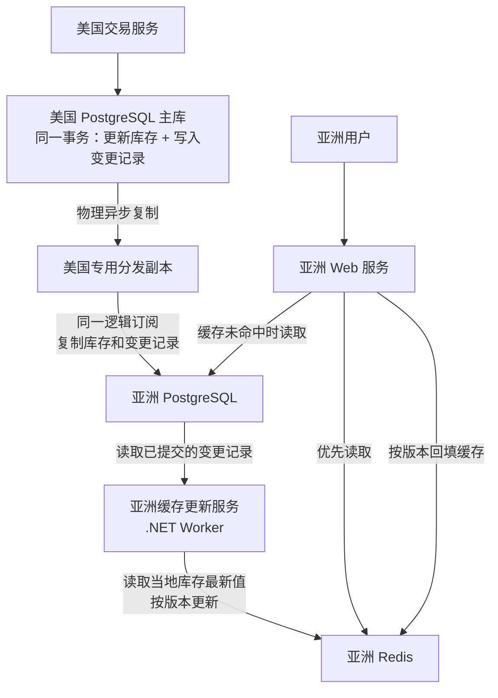

这套全球电商系统在美国设有一处仓库，交易和库存调整也集中在美国处理。其他区域负责就近提供查询，让用户查看商品和库存时，不必每次都访问美国数据库。

设计目标是全球峰值50万API QPS。暂按1%的请求用于下单估算，对应每秒约5,000单。下文围绕数据库复制和库存缓存，说明数据怎样送到各地，以及缓存怎样跟上库存变化。

## 数据库跨区域同步

美国PostgreSQL主库承担交易写入，再通过专用分发副本，把库存、商品信息和用户等数据异步发送到其他区域。



各节点的职责如下：

| 节点 | 主要职责 | 是否接受业务写入 |
| --- | --- | --- |
| 美国主库P | 保存权威的订单和库存数据，执行交易事务 | 是 |
| 同步备库HA | 在另一可用区保存已确认交易，为安全接管提供数据基础 | 正常情况下不接受 |
| 分发副本D | 接收完整WAL，解码后向海外分发数据 | 不接受 |
| 亚洲、欧洲等数据库 | 保存订阅范围内的数据，供当地查询 | 业务账号只读订阅数据 |

库存统一由美国交易服务修改。用户可以在亚洲查看库存，但创建订单、预留库存、取消后释放库存、付款确认和仓库库存调整，都要交给美国交易服务。

图中的HA表示同步备库角色。候选节点的数量和自动切换方式，由具体的高可用方案确定。

### 订单什么时候确认

订单提交和海外数据同步各有自己的进度。正常下单时，处理过程是：

1. 当地区域的服务将请求转交给美国交易服务。
2. 美国主库在一个事务里创建订单、预留库存，并产生WAL。
3. 主库与符合要求的跨可用区同步备库，将这笔事务的WAL持久保存。
4. 美国交易服务返回下单成功。
5. 分发副本继续接收主库的WAL。
6. 分发副本通过逻辑复制，将需要发布的业务变更发送到海外。
7. 海外数据库应用变更，当地查询随后可以看到新库存。

第5到第7步独立推进，第4步确认成功时不用等它们结束。

提交订单需要等同步备库HA确认，不需要等分发副本D，也不需要等亚洲或欧洲的数据库。PostgreSQL可以在同步备库保存好WAL后，再确认事务提交。对于核心交易，如果没有符合要求的同步备库，就应停止确认写入成功；降级后继续写入，也不能继续承诺RPO=0。[PostgreSQL同步复制](https://www.postgresql.org/docs/current/warm-standby.html#SYNCHRONOUS-REPLICATION)、[Patroni严格同步模式](https://patroni.readthedocs.io/en/latest/replication_modes.html)

### 日志怎样分发

P到D采用物理复制，D是一份完整的物理热备：

- 建立副本时，先恢复一份基础备份。
- 此后不断接收主库的WAL，并回放日志。
- 日志覆盖整个PostgreSQL集群，也包含订单等数据的修改。
- D只负责复制和分发，不参与下单，也不决定库存怎样增减。

因此，P到D会复制完整的物理变更，不只复制库存。需要发往海外的数据，再按照发布配置筛选。

D到海外采用逻辑复制，只发送当地查询需要的数据，不默认发送全部交易数据。PostgreSQL支持在热备上做逻辑解码：从WAL中提取数据行的变化，按发布配置筛选，再通过原生复制协议交给海外订阅端应用。[热备逻辑解码](https://www.postgresql.org/docs/current/logicaldecoding-explanation.html)、[逻辑复制架构](https://www.postgresql.org/docs/current/logical-replication-architecture.html)

## 各区域库存缓存

每个区域都部署当地PostgreSQL和Redis。PostgreSQL接收美国传来的数据，Redis承担大部分库存查询。

缓存通过两种方式更新：数据库发生变化时，由后台服务主动刷新；用户查询时发现没有缓存，则从数据库读取并补进缓存。

Redis中的库存用于页面展示。用户最终能否买到商品，仍取决于美国主库能否成功预留库存。

### 组件分工

以亚洲区域为例，其他区域采用相同方式：



图中的两个后台组件分别负责不同工作：

| 组件 | 由谁提供 | 负责什么 |
| --- | --- | --- |
| PostgreSQL复制进程 | PostgreSQL自带 | 把美国数据库的变更复制到当地 |
| 缓存更新Worker | 自行编写的.NET后台服务 | 读取当地变更，更新当地Redis |

Worker部署在各区域的Kubernetes中。每个区域独立更新自己的Redis，亚洲Redis和欧洲Redis之间不再互相复制。

库存查询与修改分别走下面两条路径：

```text
查询库存：
用户 → 当地Web服务 → 当地Redis / 当地PostgreSQL

修改库存：
用户 → 当地Web服务 → 美国交易服务 → 美国PostgreSQL主库
```

当地应用不会修改复制过来的库存业务记录，但可以写入Redis，也可以保存当地Worker的处理进度。上图只描述缓存更新，美国主库还需要另行配置跨可用区同步备库。

### 缓存格式

每个SKU使用一个Hash，保存该商品在美国仓库的库存：

```text
Key：stock:{SKU123}:US01
类型：Hash

available = 99
version   = 1024
state     = active
```

| 字段 | 含义 |
| --- | --- |
| available | 美国数据库计算的可售数量，已扣除预留的库存 |
| version | 由美国库存事务维护的递增业务版本 |
| state | 库存状态，例如active或disabled |

SKU123代表商品规格编号，US01代表仓库编号。各地采用同样的Key格式，连接的则是各自区域的Redis。

按SKU分别存储，可以单独设置过期时间，也方便把不同SKU分散到不同Redis分片，避免所有库存挤在一个大Hash里。

Redis记录当前库存，不使用`DECR`执行实际的业务扣减。下单预留、取消释放、补货和盘点调整，都在美国数据库中完成。

### 库存变化后主动刷新

每次调整库存时，美国PostgreSQL在同一个事务里完成两项操作：

```text
① 修改库存和版本：
   available：100 → 99
   version：20 → 21

② 保存变更记录：
   SKU123库存有变化，版本为21
```

这可以采用Outbox模式：修改库存时，把一条待处理的变更记录也写进数据库，两者一起提交。这样就不会出现库存已经改好，程序却在发出通知之前崩溃，导致通知没有留下的情况。

库存表和变更记录使用同一个逻辑订阅复制到亚洲。首次全量同步完成后，同一源事务中被订阅的数据变更，在当地也会保持事务一致性。Worker能够读到一条已提交的变更记录时，相应的库存变更也已经提交。[PostgreSQL逻辑复制](https://www.postgresql.org/docs/current/logical-replication.html)

亚洲Worker按下面的流程处理：

```text
找出尚未处理的变更记录
    → 根据SKU读取当地数据库的当前库存和版本
    → 比较版本后更新Redis
    → 记录本地区的处理结果
```

这里查询的是图中的当地PostgreSQL，不再转向另一台可能更滞后的只读副本。

Worker每次取出的是当前库存值，并不把事件当成“减1”命令在Redis中再执行一遍。即使同一事件处理了两次，也不会把库存重复扣掉。

可以从以下配置开始：

| 参数 | 起始配置 |
| --- | --- |
| 没有待处理事件时 | 每100ms查询一次 |
| 每批事件数量 | 最多500条 |
| 已有事件积压时 | 连续处理，不再额外等待轮询间隔 |
| 同一批出现多个相同SKU | 合并查询，只读取一次当前库存 |
| Redis中没有对应Key | 跳过，等用户首次访问时加载 |

这些值只是压测的起点，不能据此认定一个Worker就能承担全部更新量。

亚洲和欧洲各自记录处理进度，不共用一个“全球已处理”标记。处理状态保存在当地独立记录中，不改动从美国复制来的变更记录。

### 查询时补齐缓存

用户请求也会写入缓存。当Redis里没有所查SKU时，当地Web服务会查询数据库并回填：

```text
用户查询SKU123
    → Redis中没有缓存
    → 读取当地PostgreSQL
    → 得到available=99、version=21
    → 按版本规则写入Redis
    → 返回结果
```

两条写入路径的区别是：

| 写入方 | 什么时候触发 | Key不存在时 |
| --- | --- | --- |
| 缓存Worker | 当地收到库存变更 | 跳过，不为冷门商品创建缓存 |
| 当地Web服务 | 用户查询没有命中缓存 | 查询数据库后建立缓存 |

因此，Redis主要保留当地用户实际访问过的SKU。一次全球库存变化，不会自动让所有区域都多出一份该商品的缓存。

### 用版本防止旧值覆盖

查询开始时没有缓存，不代表回填时也没有。Web服务读取数据库的这段时间里，其他请求可能已经建立缓存，Worker也可能更新了它。

例如：

```text
① 请求A没有查到缓存，从数据库读到版本20，暂时还没写回。
② 请求B创建了缓存，Worker随后把缓存更新到版本21。
③ 请求A准备把版本20写入Redis。
④ 版本检查发现数据较旧，拒绝覆盖。
```

Worker和Web服务遵循同一套写入规则：

```text
Key不存在：
    Worker更新 → 跳过
    Web回填 → 创建缓存，并设置TTL

Key已存在：
    待写入版本 > 缓存版本 → 更新全部字段，重新设置TTL
    待写入版本 ≤ 缓存版本 → 保持原值，不延长TTL
```

读版本、比较大小、更新字段和设置TTL，要在同一个简短的Lua脚本中完成。这样，其他请求无法插入这几个步骤之间。如果先在应用里读取版本，再单独发送写入命令，仍然可能覆盖较新的数据。[Redis Lua原子执行](https://redis.io/docs/latest/develop/programmability/eval-intro/)

版本号统一由美国库存事务递增，各区域不通过本地时间戳判断新旧。

### 缓存有效期

TTL表示缓存还能保留多久。起始配置如下：

| 缓存内容 | TTL | 用途 |
| --- | --- | --- |
| 正常SKU，含库存为0的商品 | 随机30～40秒 | 过期后重新读取数据库，并错开过期时间 |
| 已下架SKU | 30～40秒 | 保存disabled状态和版本，防止旧版本把状态覆盖 |
| 当地数据库尚未查到的SKU | 3～5秒 | 短暂记住“未找到”，减少重复查询数据库 |

当地查不到SKU，既可能是商品不存在，也可能是新商品还没有同步过来。因此，“未找到”只保留很短时间，而且这类空值回填不能覆盖已有的有效库存缓存。

TTL按以下规则更新：

- 用户读取缓存，不延长有效期。
- 更高版本成功写入后，重新设置有效期。
- 收到重复事件或旧版本事件，不延长有效期。

修改Hash字段本身不会自动延长整个Key的TTL，所以需要在Lua脚本中明确设置。[Redis EXPIRE说明](https://redis.io/docs/latest/commands/expire/)

设置30秒TTL，不代表每隔30秒才刷新一次库存。平时由Worker及时更新，TTL负责让缓存过期后重新查询，也给遗留的旧值提供一次重新加载的机会。

这也不意味着库存最多比美国落后40秒。如果当地PostgreSQL还没追上美国主库，缓存过期后重新查询，拿到的仍可能是旧库存。

### 失败与高流量处理

| 情况 | 处理方式 |
| --- | --- |
| Redis更新失败 | 保持事件未完成，之后重试 |
| Redis已更新，但Worker随即崩溃 | 恢复后再次处理，用版本检查避免重复修改 |
| Worker停机期间积累事件 | 从仍保留的记录继续处理，按积压量增加处理能力 |
| 所需变更记录已超过保留期限 | 以当地数据库为依据重建库存缓存 |
| 热门Key过期，大量请求同时查询数据库 | 合并同一SKU的并发查询，并限制访问数据库的并发数 |
| 大量请求查询不存在的SKU | 校验参数，短期缓存空值，并限制请求频率 |
| Redis整体不可用 | 限制进入数据库的查询量，超出容量时简化库存展示 |
| 当地数据库复制延迟过大 | 告警，将库存展示改为“待确认”，下单时仍交给美国验证 |

版本检查也有适用范围。Key过期、被淘汰或故障恢复后，缓存版本可能消失或退回旧值。这时，较早发起的查询仍有机会把旧库存写回来，需要通过后续事件、过期后重新查询，或必要的缓存重建来修复。各地缓存允许短暂落后，再逐步跟上数据变化，属于最终一致方案。

面对50万QPS的设计目标，读取量和库存更新量需要分别估算：

- Redis的读压力，取决于当地查询量，以及一次请求需要读取多少个SKU。
- Worker的处理量，取决于库存发生了多少次变化，不能直接套用50万QPS。
- 如果每个区域都订阅完整库存，就都要处理全部库存变更，不能按当地用户占比分摊。
- 批量读取、合并相同SKU和使用Redis Pipeline，可以减少处理开销；需要多少Worker，仍由压测确定。

如果一个热门SKU的读取量已经打满单个Redis分片，可以在应用进程中再缓存约100～300ms的展示数据，代价是多一层短暂延迟。增加分片能够分散不同Key，却不会把同一个热点Key自动拆到多台Redis上。

### 监控更新延迟

库存展示慢了多久，需要观察整条更新流程：

```text
美国到当地PostgreSQL的复制延迟
+ 事件在当地Worker中的排队和处理时间
+ 写入Redis的时间
```

除了缓存命中率，还要观察复制心跳的延迟、最老一条未处理事件等了多久、Worker重试情况、Redis写入耗时，以及缓存未命中给数据库带来的查询负担。

例如，可以先把“复制延迟超过5秒”设为库存展示降级的触发条件，再按业务能接受的延迟调整。

用户看到“有货”后，仍需由美国主库原子地预留库存，才能确认下单成功。美国完成规定的数据库持久化确认后，就可以返回结果，不必等待海外缓存刷新。缓存延迟可能让页面显示与实际库存不一致，也可能导致下单失败；防止超卖的判断由美国交易数据库完成。
