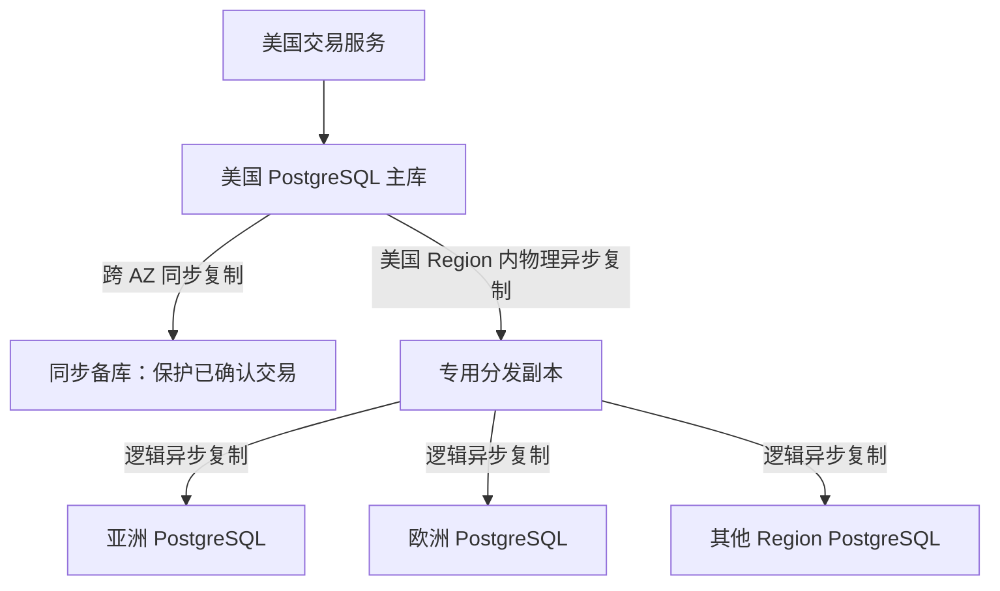
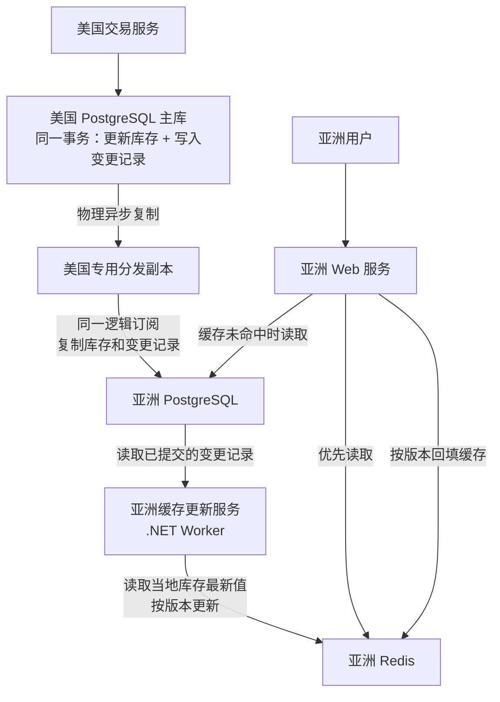

这套电商系统只有一处美国仓库，交易和库存调整由美国统一处理。其他区域保存查询副本，让用户查看商品与库存时，可以就近读取。

设计目标是全球峰值50万API QPS。若暂按1%的请求下单计算，约为每秒5,000单。这是容量估算的起点，下面说明数据库复制与库存缓存如何配合。

## 跨区域数据库复制

美国PostgreSQL主库保存订单和库存。同步备库保护已确认事务，专用分发副本则把所需数据异步送往海外。



| 节点 | 职责 | 业务写入 |
| --- | --- | --- |
| 主库P | 执行交易，保存权威订单和库存 | 接受 |
| 同步备库HA | 在其他可用区持久保存日志，准备接管 | 正常状态不接受 |
| 分发副本D | 接收完整WAL，解码并分发海外所需变更 | 不接受 |
| 海外数据库 | 接收订阅数据，提供当地查询 | 业务账号只读订阅数据 |

创建订单、预留库存、取消后的释放、付款确认和仓库调整，都由美国交易服务处理。海外可以提供库存查询，但不独立修改这些业务数据。

图中HA代表同步备库的职责，实际候选节点数和自动切换方式，由高可用方案决定。

### 下单确认时机

下单时，事务确认与海外同步分别推进。

1. 当地服务将订单请求送往美国。
2. 美国主库在同一事务中创建订单、预留库存，生成WAL。
3. 主库及符合条件的跨可用区同步备库持久保存该事务日志。
4. 美国交易服务向用户确认成功。
5. 分发副本继续接收WAL。
6. 分发副本通过逻辑复制发布所需变更。
7. 海外数据库应用变更，当地查询逐步看到新数据。

步骤5至7独立进行，成功确认无需等待分发副本或海外数据库完成同步。

核心交易如果要求RPO=0，却没有符合条件的同步备库，就应停止确认写入成功。允许降级继续写入后，新的事务不能仍承诺零损失。[PostgreSQL同步复制](https://www.postgresql.org/docs/current/warm-standby.html#SYNCHRONOUS-REPLICATION)、[Patroni同步模式](https://patroni.readthedocs.io/en/latest/replication_modes.html)

### 物理复制与逻辑分发

P到D使用物理复制。D先从基础备份建立，再持续接收、重放WAL，得到完整的物理热备。

这一段覆盖整个PostgreSQL集群的变更，包括订单数据。D只承担复制和分发，不执行交易，也不决定库存扣减。

D到海外使用逻辑复制，只发布当地需要的数据。热备上的逻辑解码从WAL中提取行变更，按发布配置筛选，再经原生复制协议送到订阅端应用。[热备逻辑解码](https://www.postgresql.org/docs/current/logicaldecoding-explanation.html)、[PostgreSQL逻辑复制架构](https://www.postgresql.org/docs/current/logical-replication-architecture.html)

因此，完整物理副本与海外查询副本的范围不同，不会默认把所有交易数据发往海外。

## 区域库存缓存

每个区域部署PostgreSQL和Redis。当地数据库接收复制数据，Redis承担主要的展示查询。

缓存有两条更新路径：Worker根据库存变更刷新已有缓存，Web服务在未命中时读取数据库并回填。商品最终能否购买，仍由美国数据库预留库存的结果决定。

### 组件职责

以亚洲为例：



| 组件 | 来源 | 工作 |
| --- | --- | --- |
| PostgreSQL复制进程 | 数据库自带 | 将美国的业务变更复制到当地 |
| 缓存Worker | 自行开发的.NET服务 | 读取当地数据，更新当地Redis |

Worker部署于各区域Kubernetes中。各地独立维护缓存，无需让亚洲与欧洲的Redis互相复制。

```text
查询库存：
用户 → 当地Web服务 → 当地Redis / 当地PostgreSQL

修改库存：
用户 → 当地Web服务 → 美国交易服务 → 美国PostgreSQL主库
```

当地应用可以写Redis、保存Worker处理进度，但不修改订阅而来的库存记录。上图展示缓存路径，美国主库还需按前述方案配置跨可用区同步备库。

### 缓存内容

以SKU和仓库为单位保存一个Hash：

```text
Key：stock:{SKU123}:US01
类型：Hash

available = 99
version   = 1024
state     = active
```

| 字段 | 含义 |
| --- | --- |
| available | 美国数据库算出的可售量，已扣除预留 |
| version | 美国库存事务维护的递增业务版本 |
| state | active、disabled等库存状态 |

SKU123为商品规格，US01为仓库。不同区域使用相同命名，各自连接当地Redis。

按SKU分键，便于独立设置TTL，也能将不同商品分散到不同分片，避免全部库存放在一个大Hash中。

Redis保存展示数据，不用DECR执行真实库存扣减。预留、释放、补货和盘点，都在美国数据库完成。

### 变更驱动刷新

美国每次修改库存，在同一事务里更新数量和版本，同时记录一条变更。

```text
① 修改库存和版本：
   available：100 → 99
   version：20 → 21

② 保存变更记录：
   SKU123库存有变化，版本为21
```

这就是Outbox的用途：业务修改和事件记录一起提交。即使程序在通知发出前退出，已提交的变更仍有记录可以继续处理。

库存表与事件表通过同一逻辑订阅复制。首次全量同步完成后，同一源事务内被订阅的变更，在当地也保持事务一致。Worker读到已提交事件时，对应的库存修改已经提交。[PostgreSQL逻辑复制](https://www.postgresql.org/docs/current/logical-replication.html)

```text
找出尚未处理的变更记录
    → 根据SKU读取当地数据库的当前库存和版本
    → 比较版本后更新Redis
    → 记录本地区的处理结果
```

Worker读取同一个当地PostgreSQL实例，不再转向可能落后的另一个只读副本。

写入Redis的是数据库当前值，而不是把事件当作“减1”指令。因此事件重试不会重复扣减库存。

可以先采用以下参数，再根据压测调整。

| 情况 | 初始处理方式 |
| --- | --- |
| 暂无事件 | 每100ms轮询 |
| 每批事件 | 最多500条 |
| 已有积压 | 连续消费，省去额外轮询等待 |
| 一批内多条事件属于同一SKU | 合并读取一次当前库存 |
| Redis不存在该Key | 跳过，首次访问时再加载 |

这些数值不构成容量保证，单个Worker能否承载更新量，需要实测。

处理进度按区域独立保存，不使用一个全球共享的“已完成”状态。当地进度也应放在独立记录中，不改写美国复制来的事件。

### 查询未命中时回填

Redis没有目标商品时，Web服务查询当地数据库，再按版本规则补入缓存。

```text
用户查询SKU123
    → Redis中没有缓存
    → 读取当地PostgreSQL
    → 得到available=99、version=21
    → 按版本规则写入Redis
    → 返回结果
```

| 写入方 | 触发原因 | Key缺失时 |
| --- | --- | --- |
| Worker | 收到库存变更 | 跳过，不为未访问商品创建缓存 |
| Web服务 | 用户查询未命中 | 从数据库加载并创建缓存 |

Redis因此主要存放当地用户访问过的商品。全球某个SKU发生变化，不会立即在每个区域都创建这个Key。

### 版本检查

Web查询数据库期间，另一个请求可能已创建缓存，Worker还可能写入更高版本。

```text
① 请求A没有查到缓存，从数据库读到版本20，暂时还没写回。
② 请求B创建了缓存，Worker随后把缓存更新到版本21。
③ 请求A准备把版本20写入Redis。
④ 版本检查发现数据较旧，拒绝覆盖。
```

两条写入路径应采用同一套规则：

```text
Key不存在：
    Worker更新 → 跳过
    Web回填 → 创建缓存，并设置TTL

Key已存在：
    待写入版本 > 缓存版本 → 更新全部字段，重新设置TTL
    待写入版本 ≤ 缓存版本 → 保持原值，不延长TTL
```

读取版本、比较、更新字段和设置TTL，需要放进一个简短Lua脚本原子执行。若应用先读版本，再单独发送写入命令，中间仍可能插入其他更新，导致旧值覆盖新值。[Redis Lua脚本](https://redis.io/docs/latest/develop/programmability/eval-intro/)

版本由美国库存事务统一递增，不能用各区域的本地时间戳比较新旧。

### 有效期

以下TTL可作为初始配置。

| 内容 | TTL | 目的 |
| --- | --- | --- |
| 正常商品，包括库存为0 | 随机30至40秒 | 到期重新读取，并分散集中失效 |
| 下架商品 | 30至40秒 | 保留disabled和版本，阻止旧数据覆盖状态 |
| 当地尚未找到的商品 | 3至5秒 | 短暂缓存空结果，减少重复回源 |

未找到可能表示商品不存在，也可能是新商品尚未复制到当地。空结果应短期保留，且不能覆盖现存的有效库存。

读取缓存不续期。成功写入更高版本后重设TTL；重复事件和较旧版本则不延长有效期。

Hash字段修改不会自动延长Key的TTL，所以Lua脚本中要明确处理过期时间。[Redis EXPIRE](https://redis.io/docs/latest/commands/expire/)

TTL不代表刷新间隔。正常更新由Worker及时完成，过期机制则帮助重新加载，并修复部分遗留旧值。

30至40秒也不是相对美国库存的延迟上限。当地数据库尚未追平时，缓存即使过期重新加载，仍可能得到旧库存。

### 故障处理

| 情况 | 应对 |
| --- | --- |
| 写Redis失败 | 事件保留为未完成，稍后重试 |
| 写入成功后Worker退出 | 重启后重试，版本检查避免重复修改 |
| Worker停机导致积压 | 消费仍保留的事件，按积压增加处理能力 |
| 待处理事件已超过保留期限 | 从当地数据库重建缓存 |
| 热门商品到期，并发回源 | 合并同SKU查询，限制数据库并发 |
| 大量访问不存在的SKU | 校验请求、短期缓存空值并限流 |
| Redis整体故障 | 限制回源，超出数据库容量时简化展示 |
| 当地复制明显滞后 | 告警，库存显示待确认，下单仍由美国核验 |

版本检查依赖缓存里的版本仍然有效。Key过期、淘汰或故障恢复后，这个版本可能消失或退回。先前读取旧数据的请求便可能重新写入旧值。

后续变更事件、到期回源或缓存重建，需要修复这类情况。这个方案允许展示短暂滞后，再逐步追上，属于最终一致。

### 高流量下的容量

50万API QPS是总体目标，需要分别估算读取与更新的工作量。

- Redis读取量由区域查询量和每次请求涉及的SKU数量决定。
- Worker负载由库存变更量决定，不能直接拿API QPS代替。
- 每个区域若订阅全部库存，就各自处理全部变更，不能按当地用户比例分摊。
- 批量读取、合并同SKU事件和Redis Pipeline可减少开销，Worker数量仍需压测确认。

单个热门SKU可能集中打满一个分片。业务接受额外短暂延迟时，可以在应用进程缓存约100至300ms的展示值。

增加分片可以分散不同Key，但同一个热点Key不会自动拆分到多个Redis节点。

### 更新延迟监控

库存从美国变更到当地缓存，要经过完整链路：

```text
美国到当地PostgreSQL的复制延迟
+ 事件在当地Worker中的排队和处理时间
+ 写入Redis的时间
```

除了命中率，还需观察复制心跳延迟、最老待处理事件的等待时间、Worker重试、Redis写入耗时，以及未命中带来的数据库负担。

例如，先以复制延迟超过5秒作为展示降级条件，再根据业务可接受的时间调整。

用户看到“有货”，仍要由美国主库原子预留成功，才确认订单。完成规定的主备持久化后即可返回，无需等待海外缓存。

展示延迟可能使页面库存不准，也可能让下单失败。是否允许预留、如何防止超卖，最终由美国交易数据库判断。
