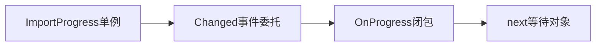

一个商品导入服务，提供了“等待下一次进度”的接口。客户端发起请求后，接口先等着；后台任务报告80%，接口就返回80。这次请求结束后，客户端可以再发起下一次请求。

后来，服务的内存持续增长。排查发现，每次进度请求结束，都会在后台服务里留下一份事件订阅。

## 问题出在请求结束之后

下面只演示一个导入任务。把代码放进.NET 8空Web项目的Program.cs即可运行：

```csharp
var builder = WebApplication.CreateBuilder(args);
builder.Services.AddSingleton<ImportProgress>();
var app = builder.Build();

app.MapGet("/progress", async (ImportProgress progress, CancellationToken token) =>
{
    var next = new TaskCompletionSource<int>(
        TaskCreationOptions.RunContinuationsAsynchronously);

    void OnProgress(int percent) => next.TrySetResult(percent);

    progress.Changed += OnProgress;
    return await next.Task.WaitAsync(token);
});

// 模拟后台任务报告进度
app.MapPost("/report", (ImportProgress progress) =>
{
    progress.Report(80);
    return Results.Ok();
});

app.MapGet("/subscribers", (ImportProgress progress) => progress.SubscriberCount);
app.Run();

public sealed class ImportProgress
{
    public event Action<int>? Changed;
    public int SubscriberCount => Changed?.GetInvocationList().Length ?? 0;
    public void Report(int percent) => Changed?.Invoke(percent);
}
```

`ImportProgress`是整个应用共用的单例。接口订阅它的Changed事件，用来等待下一次进度通知。

`TaskCompletionSource<int>`可以理解为“等待结果的通知器”：后台调用Report(80)，OnProgress就调用TrySetResult(80)，让等待中的接口返回80。

业务完成了，问题却留下了：代码只有`+=`，没有对应的`-=`。

## 请求返回了订阅还在

先用`dotnet run --urls http://127.0.0.1:5080`启动服务。

在终端一请求进度，它会等待：

```shell
curl.exe http://127.0.0.1:5080/progress
```

在终端二模拟后台任务上报进度：

```shell
curl.exe -X POST http://127.0.0.1:5080/report
```

终端一收到80，请求结束。再查看订阅数：

```shell
curl.exe http://127.0.0.1:5080/subscribers
```

结果仍是1。重复三次请求，结果变成3。如果客户端在等待时断开，原来的代码也不会退订。

单例服务还保存着回调，回调又保留着它需要的next对象，引用关系如下：



所以，HTTP请求结束并不等于这些对象失去了全部引用。只要单例还沿着事件列表引用它们，GC就不会回收。[Microsoft：事件订阅与取消](https://learn.microsoft.com/en-us/dotnet/csharp/programming-guide/events/how-to-subscribe-to-and-unsubscribe-from-events)

## 第一种修复是在finally里退订

保留前面的订阅，把接口最后一行等待改成：

```csharp
try
{
    return await next.Task.WaitAsync(token);
}
finally
{
    progress.Changed -= OnProgress;
}
```

正常拿到进度、客户端取消，或者等待时发生异常，都会经过finally，清除本次订阅。

这是最直接的修复，适合订阅逻辑只在这一个地方使用的情况。

## 第二种修复是实现IDisposable

如果多个接口需要同样的订阅逻辑，可以把“订阅、等待、退订”放进一个类：

```csharp
public sealed class ProgressSubscription : IDisposable
{
    private readonly ImportProgress _progress;
    private readonly TaskCompletionSource<int> _next =
        new(TaskCreationOptions.RunContinuationsAsynchronously);

    public ProgressSubscription(ImportProgress progress)
    {
        _progress = progress;
        _progress.Changed += OnProgress;
    }

    private void OnProgress(int percent) => _next.TrySetResult(percent);

    public Task<int> WaitAsync(CancellationToken token) =>
        _next.Task.WaitAsync(token);

    public void Dispose() => _progress.Changed -= OnProgress;
}
```

构造函数负责订阅，WaitAsync负责等待，Dispose负责退订。

接口改成下面这样，其他注册和上报代码保留：

```csharp
app.MapGet("/progress", async (ImportProgress progress, CancellationToken token) =>
{
    using var subscription = new ProgressSubscription(progress);
    return await subscription.WaitAsync(token);
});
```

`using var`会在这次接口执行结束时调用Dispose。这里保留`await`，让订阅一直有效到等待完成、取消或失败为止。[Microsoft：using与IDisposable](https://learn.microsoft.com/en-us/dotnet/standard/garbage-collection/using-objects)

仅仅写上IDisposable不会自动清理，GC也不会替你调用Dispose。要使用using，或者明确调用Dispose。

ProgressSubscription是接口自己new出来的，由接口负责释放。ImportProgress仍然作为DI单例存在，为其他请求提供进度通知。

## 用gcdump检查修复结果

服务运行时，可以采集托管堆：

```shell
dotnet-gcdump ps
dotnet-gcdump collect -p 1234 -o progress-leak.gcdump
```

把1234换成实际进程ID。用Windows上的Visual Studio或PerfView比较多次请求前后的对象数量，再沿引用路径检查事件是否还保留着旧回调和等待对象。[Microsoft：dotnet-gcdump](https://learn.microsoft.com/en-us/dotnet/core/diagnostics/dotnet-gcdump)

线上采集会触发Gen 2完整GC，并有额外内存开销。先确认暂停和内存余量，堆很大且延迟敏感时应避免直接采集。

对三种写法分别验证，结果如下。两列使用各自新建的进度服务：

| 写法 | 三次正常返回后的残留订阅 | 一次取消后的残留订阅 |
| --- | --- | --- |
| 原来遗漏退订 | 3 | 1 |
| finally退订 | 0 | 0 |
| IDisposable配合using | 0 | 0 |
